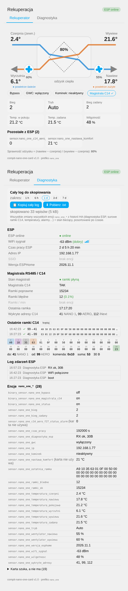
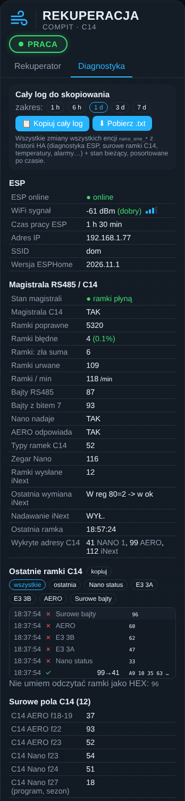

# Compit Nano One – karta rekuperacji dla Home Assistant

Karta Lovelace dla rekuperacji sterowanej przez **Compit Nano One** (RS485, protokół C14), czytanej przez ESP z ESPHome.
Jeden plik JS, bez zależności (nie wymaga button-card, card-mod ani apexcharts).





Podgląd jest zrobiony na przykładowych wartościach.

## Co jest w karcie

**Zakładka Rekuperator** (od v1.2 ciemny wygląd wg wzoru, jasny: `theme: light`)
- nagłówek REKUPERACJA / COMPIT · C14 z plakietką PRACA / WYBIEG / STOP / OFFLINE (`status_wentylatorow`, status ESP)
- schemat wymiennika: kafle czerpnia, wywiew, nawiew, wyrzut, świecące strumienie, animacja przepływu, gdy wentylatory pracują, obejście przy otwartym bypassie
- okrągły wskaźnik biegu z % wentylatora nawiewu
- dolny pasek: PROGRAM, BYPASS, SEZON, FILTR
- schemat centrali: czerpnia, nawiew, wywiew, wyrzutnia, kręcące się wentylatory z % wysterowania, stan bypassu
- sprawność odzysku (z encji `sprawnosc_odzysku`, a jak jej nie ma, liczona z temperatur)
- bieg, tryb, bieg zadany, harmonogram, temp. pokojowa i zadana, wilgotność, CO₂, przepływ, obroty, nagrzewnica, GWC, kominek, filtry, alarm, ostrzeżenie, godziny pracy, wersja Nano One
- **Pozostałe z ESP**: każda inna encja z tym samym prefiksem, której karta nie zna z nazwy, pokazuje się sama jako kafel. Jak dodasz coś w YAML-u, pojawi się w karcie bez aktualizacji karty.

**Zakładka Diagnostyka**
- **Cały log do skopiowania**: zakres 1 h / 6 h / 1 d / 3 d / 7 d, przycisk *Kopiuj cały log* i *Pobierz .txt*. Bierze całą historię HA wszystkich encji `<prefix>_*` (diagnostyka ESP, surowe ramki C14, temperatury, alarmy…) plus stan bieżący, posortowane po czasie. Działa też, gdy HA jest po `http://` (wtedy kopiuje starym sposobem, a jak przeglądarka nie pozwoli, pokazuje log w polu do zaznaczenia).
- ESP: online/offline, sygnał WiFi z oceną, czas pracy, IP, SSID, wersja ESPHome
- magistrala RS485/C14: stan (ramki płyną / cisza / brak), ramki poprawne i błędne z % błędów, ramki na minutę, czas ostatniej ramki, wykryte adresy z nazwami (41 = NANO 1, 99 = AERO, 112 = iNext…)
- ostatnie ramki C14 (historia + na żywo) z dekoderem: bajty w HEX, adres docelowy, nadawca, komenda, suma, znacznik końca `#`, pary H/L przeliczone na temperatury
- log zdarzeń ESP (encja `diagnostyka_esp` + zmiany alarmu, trybu, biegu, bypassu, filtrów, statusu)
- lista wszystkich encji z prefiksem i lista encji, których karta szuka, a ich nie ma

Kliknięcie w wartość otwiera standardowe okno encji HA. Karta tylko czyta, niczego nie zmienia w centrali.

## Sterowanie z karty (YAML v1.6, zapis do Nano jako iNext)

Wszystko zmieniasz w karcie, nie w encjach ESP. Przyciski pojawiają się, gdy w HA są encje sterujące z ESPHome:
- klik we wskaźnik biegu albo w PROGRAM: Ręczny Stop / Ręczny bieg 1–3 / Wg zegara / Świąteczny / Poza domem (`select.<prefix>_ustaw_tryb`)
- klik w BYPASS: Zamknięty / Auto / Otwarty (`select.<prefix>_ustaw_bypass`)
- klik w SEZON: Zima / Lato (`select.<prefix>_ustaw_sezon`)
- Temperatury zadane z +/−: ręczna, dzień, noc, poza domem, 5–40 °C co 0,1 (`number.*`)
- Biegi % z +/−: nawiew i wywiew dla biegów 1–3 i wietrzenia, 10–100 % (`number.*`)
- **klik w samą wartość** (podkreśloną) otwiera pole do wpisania liczby z klawiatury (przecinek albo kropka), zapis przyciskiem OK albo Enterem, Esc anuluje
- **klik w kafle** Bieg / Tryb otwiera wybór trybu, Temp. zadana otwiera temperatury zadane, plakietki Bypass / Sezon otwierają swoje listy (kafle z ołówkiem ✎ da się zmieniać)

Ze starszym YAML-em (v1.4) karta dalej działa na `ustaw_bieg`, `ustaw_program`, przełączniku `wietrzenie` i `nadawanie_inext`.

**Bez szukania blokady:** przełącznik `switch.<prefix>_sterowanie_z_ha_inext` („Sterowanie z HA (iNext)”) karta włącza sama przy pierwszej zmianie, czeka, aż ESP potwierdzi, i dopiero wysyła wartość. Po każdej zmianie pokazuje „✓ wysłane” albo „✗ błąd”. Gdy ESP nie ma encji sterujących, karta pokazuje czerwony pasek „Wgraj na ESP YAML v1.6” z listą brakujących encji, a gdy ESP jest offline, mówi to wprost.

## Harmonogram, strefy, reguły (v2.3)

Karta tylko ustawia. Całą robotę robi Home Assistant, więc działa też bez otwartej karty. Po kliknięciu **Zapisz w HA** (konto administratora) karta tworzy albo aktualizuje:

- automatykę **Rekuperacja – sterownik** (`compit_rekuperacja_sterownik`),
- strefy `zone.rekuperacja_1` i `zone.rekuperacja_2` (pasywne, nie psują stanu „w domu” telefonów),
- przełącznik **`input_boolean.rekuperacja_wietrzenie`**, który możesz wstawić na dowolną swoją kartę.

Stare automatyki z v1.9–v2.2 (`compit_rekuperacja_harmonogram`, `_strefa_1`, `_strefa_2`) karta kasuje przy zapisie, a ich ustawienia przenosi. Ustawienia karty są zapisane w sterowniku, więc w każdej przeglądarce widać to samo. Sterownika nie edytuj ręcznie, bo karta nadpisze go przy następnym zapisie. **Usuń wszystko z HA** kasuje sterownik, strefy i przełącznik.

**Jak sterownik decyduje** (co minutę i przy każdej zmianie warunku, zapisuje do Nano tylko to, co się różni):

1. nikt nie jest w strefie 1 → tryb wyjazdu (albo tryb strefy 2, gdy ktoś jest w strefie 2),
2. przełącznik wietrzenia WŁ. → wietrzenie z ustawionymi % przez X min (potem sam się wyłącza),
3. reguła (pierwsza pasująca) → % nawiewu / wywiewu, osobno dzień i noc,
4. cykl dzienny / nocny → „co X h na Y min” z ustawionymi %,
5. harmonogram tygodniowy → tryb i % z wykresu na tę godzinę.

**Harmonogram:** wykres Pn–Nd × 0–24 h z kolorowymi blokami trybów, pasem nocy, znacznikami cykli i kreską „teraz”. Klik w blok = edycja (dni, godzina, tryb, temperatura, %), dwuklik albo klik w pusty pasek = nowy wpis, przeciąganie lewej krawędzi bloku = zmiana godziny co 15 min. Lista wpisów jest zwinięta pod wykresem. Puste % we wpisie = **domyślne % biegu** z tabelki.

**Reguły:** warunki z dowolnych encji HA (włączone / wyłączone / większe / mniejsze / równe), wszystkie naraz, np. `light.lazienka` włączone i przepływ wody > 0. Działają tylko, gdy ktoś jest w strefie 1. „Trzymaj jeszcze N min” trzyma regułę po zniknięciu warunku. Reguły, cykle i wietrzenie (bez wietrzenia w YAML) jadą na wybranym biegu (domyślnie 3) z własnymi %.

**Strefy:** dowolna liczba telefonów (`device_tracker` z aplikacji HA albo `person`, liczy się GPS), okręgi na mapie HA. Środek przeciągasz kropką, promień uchwytem na krawędzi, albo klikasz w mapę. Wjazd pierwszego telefonu do strefy (z zaznaczonym wietrzeniem) włącza przełącznik wietrzenia. Telefon, który nie raportował dłużej niż „Nieaktualny po” (domyślnie 30 min), się nie liczy. 0 wyłącza to sprawdzanie. Odległości liczone w km, więc HA musi mieć system metryczny.

**Wietrzenie jako przycisk (v2.9):** przy „Zapisz w HA” karta zakłada też `input_button.rekuperacja_wietrzenie_teraz`. Naciśnięcie = wietrzenie na czas i z % ustawionymi w Strefach w sekcji **Wietrzenie z przycisku** (domyślnie 30 min, 90/90 %), potem samo wraca. Działa też, gdy nikogo nie ma, i ma pierwszeństwo przed wszystkim. Naciśnięcie w trakcie liczy czas od nowa, przerywasz przełącznikiem `input_boolean.rekuperacja_wietrzenie_przycisk` albo „przerwij” w karcie. Karta przycisku do wklejenia na pulpit:

```yaml
type: button
entity: input_button.rekuperacja_wietrzenie_teraz
name: Wietrzenie
icon: mdi:weather-windy
tap_action:
  action: perform-action
  perform_action: input_button.press
  target:
    entity_id: input_button.rekuperacja_wietrzenie_teraz
```

**Lewy pasek:** przy każdym otwarciu (konto administratora) karta sprawdza, czy w HA jest panel **Rekuperacja** (`/rekuperacja-nano`) z tą kartą na cały ekran, i jak go nie ma, zakłada go sama. Jak HA odmówi, na górze zakładki Rekuperator jest pasek z przyciskiem, błędem z HA i instrukcją do dodania ręcznie. Wyłączysz to opcją `sidebar: false`.

Mapa w Strefach to od v2.6 **OpenStreetMap bez żadnego klucza API** (biblioteka Leaflet 1.9.4 wbudowana w plik karty od v2.7, bez CDN; internet potrzebny tylko na kafelki mapy z tile.openstreetmap.org). W ciemnym motywie podkład jest przyciemniony. Klik w mapę stawia znacznik środka wybranej strefy (przyciski Strefa 1 / Strefa 2 nad mapą) i rysuje okrąg z promieniem. Opcje karty: `map: ha` = stara mapa HA (ha-map), `map_tiles: <adres>` = własny podkład. Jak mapa nie wstanie, karta pisze dlaczego, a środek strefy wpisujesz ręcznie.

**Harmonogram strefy 1** (pod mapą w Strefach, strefa 2 bez zmian):
1. **Wjazd** (pierwszy telefon): wietrzenie na X min z % nawiewu i wywiewu.
2. **Wyjazd** (ostatni telefon wyszedł): wietrzenie po wyjeździe na X min z % nawiewu/wywiewu (przełącznik `input_boolean.rekuperacja_wietrzenie_wyjazd`, karta zakłada go przy zapisie i sama gasi po czasie).
3. **Nikogo nie ma**: tryb (i % przy trybie z biegiem) po wietrzeniu.
4. **Wietrzenie co jakiś czas**: cykle dzień/noc (co ile h, na ile min, %), te same co w zakładce Harmonogram.
5. **Czujniki**: lista świateł i lista czujników wody, a do tego trzy osobne ustawienia: **tylko światło**, **tylko woda**, **światło i woda naraz** (każde z własnym nawiewem, wywiewem i czasem „po wyłączeniu jeszcze X min”). Woda jest aktywna, gdy stan to `on` albo wartość jest większa od progu. Jak pasuje kilka naraz, wygrywa ten z większą sumą nawiew + wywiew.
6. **Harmonogram tygodniowy**: ten sam co w zakładce Harmonogram, działa gdy ktoś jest w strefie.

Kolejność w sterowniku: nikogo w strefie 1 → wietrzenie po wyjeździe → strefa 2 / „nikogo nie ma”; ktoś jest → wietrzenie wjazdu → czujniki → reguły → cykle → harmonogram.

**Sezon lato / zima** (zakładka Harmonogram, na górze): po włączeniu sterownik sam przełącza sezon według temperatury zewnętrznej (domyślnie BT1 z pompy, a jak jej nie ma, czerpnia; można wybrać inny czujnik °C). Zima włącza się poniżej progu, lato powyżej drugiego progu, i dopiero gdy temperatura trzyma się za progiem przez X h (domyślnie 12 / 16 °C, 6 h). Przyciski „zima teraz” / „lato teraz” przełączają ręcznie. Stan sezonu to `input_boolean.rekuperacja_lato` (ON = lato), karta zakłada go przy zapisie.
- Dwa harmonogramy tygodniowe: **zima** (dotychczasowy) i **lato** (na start kopia zimy). Nad wykresem wybierasz, który edytujesz, a przycisk „skopiuj z …” kopiuje cały harmonogram z drugiego sezonu.
- Temperatury zadane (ręczna, dzień, noc, poza domem) osobno na zimę i lato. Sterownik wpisuje je do reku przy zmianie sezonu.
- Każdy wpis harmonogramu ma własną **temperaturę**. Pusta oznacza „ręczną” z danego sezonu.
- Opcjonalnie przy zmianie sezonu przestawia też SEZON w ESP (wybierasz, która opcja to zima, a która lato).

**PROGRAM → Strefa:** w wyborze trybu (tam gdzie Ręczny Stop / Ręczny bieg 1–3) jest opcja **Strefa**. Włącza sterownik i od razu go odpala, więc tryb i % idą wg tego, co ustawione w Strefach (wyjazd, strefa 2, a w domu harmonogram z regułami). Na pasku widać wtedy `STREFA · <tryb>`. Wybór innego trybu ręcznie wyłącza Strefę (sterownik), żeby po minucie nie nadpisał ręcznego wyboru. Strefa działa dopiero po kliknięciu **Zapisz w HA** w zakładce Strefy.

## Instalacja przez HACS

1. HACS → ⋮ → **Custom repositories** → `https://github.com/voltronicpl/compit-nano-one-ha`, typ **Dashboard** → Dodaj → Pobierz. Przeładuj przeglądarkę.
2. Dodaj kartę:
   ```yaml
   type: custom:compit-nano-one-card
   # opcjonalnie:
   # prefix: nano_one          # początek ID encji z ESPHome (domyślnie nano_one)
   # title: Rekuperacja
   # theme: light             # jasny wygląd w kolorach motywu HA (domyślnie ciemny wg wzoru)
   # niepewne: [t_czerpnia]   # które temperatury oznaczać "?" (domyślnie żadne)
   # tab: diagnostyka          # zakładka startowa: rekuperator | harmonogram | strefy | diagnostyka
   # zewn: sensor.hydrolution_temperatura_zewnetrzna_bt1   # temp. zewnętrzna z pompy ciepła (BT1), false = bez kafla
   # sidebar: false            # nie dodawaj panelu Rekuperacja w pasku bocznym
   # history_hours: 6          # ile godzin wstecz pokazuje ramki i log w Diagnostyce
   # entities:                 # gdy jakaś encja ma inne ID
   #   t_nawiew: sensor.moja_temperatura_nawiewu
   ```

## Encje

Karta szuka encji `<domena>.<prefix>_<końcówka>`. Jeśli nie ma jej w podanej domenie, szuka tej samej końcówki w innych (sensor, binary_sensor, select, number, switch…). Każdą można nadpisać w `entities:`.

Surowa ramka (`ostatnia_ramka`) to tekst HEX, np. `A9 10 35 63 … 23`. Może być ze spacjami lub bez, kilka ramek można rozdzielić `|` albo nową linią.

| klucz | domyślna encja | co to |
|---|---|---|
| `t_czerpnia` | `sensor.<prefix>_temperatura_czerpni` | Czerpnia (zewn.) |
| `t_nawiew` | `sensor.<prefix>_temperatura_nawiewu` | Nawiew |
| `t_wywiew` | `sensor.<prefix>_temperatura_wywiewu` | Wywiew |
| `t_wyrzutnia` | `sensor.<prefix>_temperatura_wyrzutni` | Wyrzutnia |
| `t_pokoj` | `sensor.<prefix>_temperatura_pokojowa` | Temp. w pokoju |
| `t_zadana` | `sensor.<prefix>_temperatura_zadana` | Temp. zadana |
| `wilgotnosc` | `sensor.<prefix>_wilgotnosc` | Wilgotność |
| `co2` | `sensor.<prefix>_co2` | CO₂ |
| `bieg` | `sensor.<prefix>_bieg` | Bieg |
| `went_nawiew` | `sensor.<prefix>_wentylator_nawiewu` | Went. nawiewu |
| `went_wywiew` | `sensor.<prefix>_wentylator_wywiewu` | Went. wywiewu |
| `tryb` | `sensor.<prefix>_tryb` | Tryb |
| `bypass` | `binary_sensor.<prefix>_bypass` | Bypass |
| `nagrzewnica` | `binary_sensor.<prefix>_nagrzewnica` | Nagrzewnica |
| `rozmrazanie` | `binary_sensor.<prefix>_rozmrazanie` | Rozmrażanie |
| `filtr` | `sensor.<prefix>_filtr` | Filtry |
| `filtr_dni` | `sensor.<prefix>_filtr_dni_do_wymiany` | Filtry: dni do wymiany |
| `alarm` | `sensor.<prefix>_alarm` | Alarm |
| `ostrzezenie` | `sensor.<prefix>_ostrzezenie` | Ostrzeżenie |
| `obroty_nawiew` | `sensor.<prefix>_obroty_nawiewu` | Obroty nawiewu |
| `obroty_wywiew` | `sensor.<prefix>_obroty_wywiewu` | Obroty wywiewu |
| `przeplyw` | `sensor.<prefix>_przeplyw` | Przepływ |
| `t_nagrzewnica` | `sensor.<prefix>_temperatura_nagrzewnicy` | Temp. nagrzewnicy |
| `t_gwc` | `sensor.<prefix>_temperatura_gwc` | Temp. GWC |
| `gwc` | `sensor.<prefix>_gwc` | GWC |
| `kominek` | `sensor.<prefix>_kominek` | Kominek |
| `harmonogram` | `sensor.<prefix>_harmonogram` | Harmonogram |
| `bieg_zadany` | `sensor.<prefix>_bieg_zadany` | Bieg zadany |
| `sprawnosc` | `sensor.<prefix>_sprawnosc_odzysku` | Sprawność odzysku |
| `godziny_pracy` | `sensor.<prefix>_godziny_pracy` | Godziny pracy |
| `wersja_nano` | `sensor.<prefix>_wersja_nano_one` | Wersja Nano One |
| `sezon` | `sensor.<prefix>_sezon` | Sezon |
| `sezon_rej` | `sensor.<prefix>_sezon_rejestr` | Sezon (rejestr) |
| `bypass_tryb` | `sensor.<prefix>_bypass_tryb` | Bypass tryb |
| `bypass_rej` | `sensor.<prefix>_bypass_rejestr` | Bypass (rejestr) |
| `wietrzenie` | `sensor.<prefix>_wietrzenie` | Wietrzenie |
| `urlop` | `sensor.<prefix>_urlop` | Urlop |
| `poza_domem` | `sensor.<prefix>_poza_domem` | Poza domem |
| `tryb_term` | `sensor.<prefix>_tryb_termostatu_rejestr` | Tryb termostatu |
| `went_aktywna` | `binary_sensor.<prefix>_wentylacja_aktywna` | Wentylacja |
| `chlodzenie` | `binary_sensor.<prefix>_zapotrzebowanie_na_chlodzenie` | Chłodzenie |
| `n_komfort` | `sensor.<prefix>_nastawa_komfort` | Komfort |
| `n_eko` | `sensor.<prefix>_nastawa_eko` | Eko |
| `n_chlodzenie` | `sensor.<prefix>_nastawa_chlodzenie` | Chłodzenie |
| `n_reczna` | `sensor.<prefix>_nastawa_reczna` | Ręczna |
| `n_poza` | `sensor.<prefix>_nastawa_poza_domem` | Poza domem |
| `aero_moc` | `sensor.<prefix>_aero_moc_centrali` | Moc centrali AERO |
| `zad_nawiew` | `sensor.<prefix>_wentylacja_nawiew_zadany` | Nawiew zadany |
| `zad_wywiew` | `sensor.<prefix>_wentylacja_wywiew_zadany` | Wywiew zadany |
| `status` | `binary_sensor.<prefix>_status` | ESP online |
| `wifi` | `sensor.<prefix>_wifi_sygnal` | WiFi sygnał |
| `uptime` | `sensor.<prefix>_czas_pracy` | Czas pracy ESP |
| `ip` | `sensor.<prefix>_ip` | Adres IP |
| `ssid` | `sensor.<prefix>_ssid` | SSID |
| `wersja` | `sensor.<prefix>_wersja_esphome` | Wersja ESPHome |
| `diag` | `sensor.<prefix>_diagnostyka_esp` | Diagnostyka ESP |
| `ramka` | `sensor.<prefix>_ostatnia_ramka` | Ostatnia ramka C14 |
| `ramki_ok` | `sensor.<prefix>_ramki_ok` | Ramki poprawne |
| `ramki_bledne` | `sensor.<prefix>_ramki_bledne` | Ramki błędne |
| `ramki_min` | `sensor.<prefix>_ramki_na_minute` | Ramki / min |
| `ramka_wiek` | `sensor.<prefix>_wiek_ostatniej_ramki` | Od ostatniej ramki |
| `adresy` | `sensor.<prefix>_wykryte_adresy` | Wykryte adresy C14 |
| `magistrala` | `binary_sensor.<prefix>_magistrala_c14` | Magistrala C14 |
| `bajty` | `sensor.<prefix>_bajty_rs485` | Bajty RS485 |
| `bajty_b7` | `sensor.<prefix>_bajty_z_bitem_7` | Bajty z bitem 7 |
| `ramki_suma` | `sensor.<prefix>_ramki_zla_suma` | Ramki: zła suma |
| `ramki_urwane` | `sensor.<prefix>_ramki_urwane` | Ramki urwane |
| `nano_nadaje` | `binary_sensor.<prefix>_nano_nadaje` | Nano nadaje |
| `aero_odp` | `binary_sensor.<prefix>_aero_odpowiada` | AERO odpowiada |
| `typy` | `sensor.<prefix>_c14_typy_ramek` | Typy ramek C14 |
| `zegar` | `sensor.<prefix>_zegar_nano` | Zegar Nano |
| `rejestry` | `sensor.<prefix>_c14_rejestry_nano` | Rejestry Nano |
| `r_nano_st` | `sensor.<prefix>_c14_ramka_nano_status` | Nano status |
| `r_nano_nast` | `sensor.<prefix>_c14_ramka_nano_nastawy` | Nano nastawy |
| `r_e3_3a` | `sensor.<prefix>_c14_ramka_e3_strona_3a` | E3 3A |
| `r_e3_3b` | `sensor.<prefix>_c14_ramka_e3_strona_3b` | E3 3B |
| `r_aero` | `sensor.<prefix>_c14_ramka_aero` | AERO |
| `r_bajty` | `sensor.<prefix>_surowe_bajty` | Surowe bajty |
| `status_went` | `sensor.<prefix>_status_wentylatorow` | Status wentylatorów |
| `bieg_centr` | `sensor.<prefix>_bieg_centrali` | Bieg centrali |
| `harm_akt` | `binary_sensor.<prefix>_harmonogram_aktywny` | Harmonogram |
| `set_tryb` | `select.<prefix>_ustaw_tryb` | Tryb pracy |
| `set_bieg` | `select.<prefix>_ustaw_bieg` | Bieg |
| `set_program` | `select.<prefix>_ustaw_program` | Program |
| `set_sezon` | `select.<prefix>_ustaw_sezon` | Sezon |
| `set_bypass` | `select.<prefix>_ustaw_bypass` | Bypass |
| `sw_wietrz` | `switch.<prefix>_wietrzenie` | Wietrzenie |
| `nadawanie` | `switch.<prefix>_sterowanie_z_ha_inext` lub `_sterowanie_z_ha` lub `_nadawanie_inext` | Sterowanie z HA (iNext) |
| `t_reczna` | `number.<prefix>_temperatura_reczna` | Ręczna |
| `t_dzien` | `number.<prefix>_temperatura_dzien` | Dzień |
| `t_noc` | `number.<prefix>_temperatura_noc` | Noc |
| `t_poza` | `number.<prefix>_temperatura_poza_domem` | Poza domem |
| `p_n1` | `number.<prefix>_nawiew_bieg_1` | Nawiew bieg 1 |
| `p_n2` | `number.<prefix>_nawiew_bieg_2` | Nawiew bieg 2 |
| `p_n3` | `number.<prefix>_nawiew_bieg_3` | Nawiew bieg 3 |
| `p_nw` | `number.<prefix>_nawiew_wietrzenie` | Nawiew wietrzenie |
| `p_w1` | `number.<prefix>_wywiew_bieg_1` | Wywiew bieg 1 |
| `p_w2` | `number.<prefix>_wywiew_bieg_2` | Wywiew bieg 2 |
| `p_w3` | `number.<prefix>_wywiew_bieg_3` | Wywiew bieg 3 |
| `p_ww` | `number.<prefix>_wywiew_wietrzenie` | Wywiew wietrzenie |
| `ramki_tx` | `sensor.<prefix>_ramki_wyslane_inext` | Ramki wysłane iNext |
| `inext` | `sensor.<prefix>_c14_inext` | Ostatnia wymiana iNext |

Kafle encji, których nie ma w HA (np. filtry, alarm, CO₂ w YAML v1.3), są ukryte i pojawią się same, jak dojdą do YAML-a. Tekstowe encje (np. `gwc`, `kominek`, `sezon`) pokazują się jako plakietki ze stanem. Encje z „?” w nazwie w YAML-u (mapowanie niepewne) mają pomarańczowy znak **?** na kaflach i „(?)” na schemacie.

Encje diagnostyczne i konfiguracyjne (`entity_category` w ESPHome) nie trafiają do „Pozostałe z ESP” na Rekuperatorze. Są w Diagnostyce, w sekcjach **Surowe pola C14**, **Rejestry Nano**, **Parametry serwisowe** i **Ustawienia ESP**.

## Powiązane repo

- [ha-karta-pompa-ciepla](https://github.com/voltronicpl/ha-karta-pompa-ciepla) – karta pompy MHI Hydrolution. Od v1.8 ta karta pokazuje kafel **Na zewnątrz (pompa BT1)** z czujnika pompy i różnicę względem czerpni (duża różnica = GWC albo nagrzewnica grzeje czerpnię). Inna nazwa encji: `zewn:` w karcie, bez kafla: `zewn: false`. Karta pompy od v1.51 pokazuje z kolei temp. pokoju, CO₂ i wilgotność z reku.
- [ems](https://github.com/voltronicpl/ems) – EMS falownika. Moc albo energię reku można podać w EMS jako źródło „Rekuperacja” (Ustawienia → Historia do nauki, od v0.6.68).

## Wersje

- **v2.10** – wietrzenie z przycisku ma własny czas i % (Strefy → Wietrzenie z przycisku), osobny przełącznik `input_boolean.rekuperacja_wietrzenie_przycisk`, działa też gdy nikogo nie ma i ma pierwszeństwo.
- **v2.9** – encja-przycisk `input_button.rekuperacja_wietrzenie_teraz` (naciśnięcie = wietrzenie na ustawiony czas, ponowne = od nowa), w Sterowaniu przycisk „Wietrzenie teraz” z licznikiem minut i „przerwij”, gotowa karta przycisku w README.
- **v2.8** – sezon lato/zima wg temperatury zewnętrznej (progi + czas trzymania, ręczne przełączenie), osobne harmonogramy lato i zima, osobne temperatury zadane na sezon, temperatura w każdym wpisie (domyślnie ręczna z sezonu), opcjonalnie SEZON w ESP.
- **v2.7** – Leaflet (licencja BSD-2) wbudowany w plik karty, więc mapa nie zależy od unpkg/jsdelivr; CDN zostaje tylko jako zapas; karta nie nadpisuje globalnego `window.L`.
- **v2.6** – mapa w Strefach domyślnie na OpenStreetMap bez klucza API (zamiast mapy HA / CARTO), Leaflet z unpkg albo jsdelivr, komunikat gdy podkład się nie ładuje, opcje `map: ha` i `map_tiles:`.
- **v2.5** – w Strefach sekcja **Harmonogram strefy 1**: wjazd (wietrzenie min + %), wyjazd (nowe: wietrzenie po wyjeździe min + %), nikogo nie ma (tryb + %), wietrzenie co jakiś czas, czujniki światło / woda / światło+woda osobno (%, czas po wyłączeniu, najsilniejszy wygrywa), harmonogram tygodniowy pod spodem.
- **v2.4** – mapa w Strefach znowu działa: jak mapa HA (ha-map) nie wstanie, karta ładuje Leaflet z unpkg; klik w mapę stawia znacznik środka strefy i rysuje okrąg; w PROGRAM nowa opcja **Strefa** (sterownik wg stref), ręczny wybór trybu wyłącza Strefę.
- **v2.3** – jeden sterownik w HA zamiast 3 automatyk: harmonogram tylko gdy ktoś w strefie, noc, reguły z encji HA (np. łazienka), cykle dzień/noc, przełącznik `input_boolean.rekuperacja_wietrzenie`, linia „teraz steruje”; harmonogram jako wykres tygodniowy z przeciąganiem; mapa nie wraca na środek, przeciąganie środka i promienia; na szerokim ekranie mały schemat i 2–3 kolumny.
- **v2.2** – panel w lewym pasku sprawdzany przy każdym otwarciu, pasek z przyciskiem „Dodaj Rekuperację do lewego paska”, błędem z HA i instrukcją ręczną; mapa w Strefach z HA (ha-map) zamiast unpkg / OpenStreetMap.
- **v2.1** – wiatraczki i przepływ kręcą się z prędkością wentylatorów: nawiew z `wentylator_nawiewu`, wywiew z `wentylator_wywiewu` (0 % = stoi), zmiana % płynnie przyspiesza / zwalnia, animacja nie zaczyna się od nowa przy odświeżeniu karty.
- **v2.0** – v1.8 (kafel Na zewnątrz z pompy BT1) + v1.9 (pasek boczny, Harmonogram, Strefy) razem w jednej wersji.
- **v1.9** – panel Rekuperacja w pasku bocznym, zakładka Harmonogram (tygodniowy, tworzy automatykę w HA), zakładka Strefy (telefony, mapa z okręgami, strefa 1 + opcjonalna strefa 2, wjazd = wietrzenie X min i tryb normalny, wyjazd = przywrócenie % i tryb wyjazdu), w Sterowaniu linia „ostatnio sterowało”, wyzwolenia automatyk w logu.
- **v1.8** – kafel **Na zewnątrz (pompa BT1)**: temperatura zewnętrzna z pompy ciepła (`sensor.hydrolution_temperatura_zewnetrzna_bt1`, opcja `zewn:`) i różnica do czerpni. Bez encji pompy kafla nie ma.
- **v1.7** – pod YAML v1.8: kafle temperatur bez wartości pokazują „brak czujnika”, domyślnie bez znaku „?” przy czerpni i wywiewie (`niepewne:` dalej działa), sprawność odzysku mówi, którego czujnika brakuje.
- **v1.6** – encje szukane też po urządzeniu (gdy HA nadał im inne ID niż `<prefix>_…`), w Diagnostyce i w kopiowanym logu lista brakujących encji sterujących oraz encji wyłączonych w rejestrze HA.
- **v1.5** – karta sama włącza „Sterowanie z HA” przed zapisem (bez pytania i szukania przełącznika), komunikaty ✓/✗ po każdej zmianie, czerwony pasek „Wgraj na ESP YAML v1.6” z listą brakujących encji, pasek „ESP offline”, sekcja Sterowanie widoczna zawsze.
- **v1.4** – każda wartość klikalna i edytowalna w karcie (wpisywanie liczb, kafle Bieg/Tryb/Temp. zadana i plakietki Bypass/Sezon otwierają wybór), karta przerysowuje się tylko przy zmianie encji `nano_one_*` i nigdy w trakcie kliknięcia (koniec skakania i gubienia klików), łapanie zdublowanych encji `_2`/`_3` z ostrzeżeniem w Diagnostyce.
- **v1.3** – sterowanie z karty pod YAML v1.6: jeden wybór trybu (`ustaw_tryb`: ręczny stop/bieg 1–3, wg zegara, świąteczny, poza domem) z wskaźnika biegu i z PROGRAM, blokada „Sterowanie z HA (iNext)”, warianty nazw encji (karta działa ze starym i nowym YAML-em).
- **v1.2** – wygląd wg wzoru (ciemny panel, schemat wymiennika z kaflami, wskaźnik biegu, pasek PROGRAM/BYPASS/SEZON/FILTR, plakietka PRACA), sterowanie pod YAML v1.4 (bieg, program, bypass, sezon, wietrzenie, temperatury zadane, % biegów) z blokadą „Nadawanie iNext”, w Diagnostyce ramki wysłane iNext i ostatnia wymiana iNext, opcje `theme` i `niepewne`.
- **v1.1** – pod YAML v1.3: plakietki (wentylacja, bypass tryb, sezon, chłodzenie, wietrzenie, urlop, poza domem), sekcja Nastawy, znacznik „?” dla niepewnych encji, encje diagnostyczne przeniesione do Diagnostyki (surowe pola C14, rejestry, serwis, ustawienia ESP), wszystkie ramki C14 (Nano status/nastawy, E3 3A/3B, AERO, surowe bajty) z przełącznikiem źródła, więcej liczników magistrali.
- **v1.0** – pierwsza wersja: zakładki Rekuperator i Diagnostyka, kopiowanie i pobieranie całego logu, dekoder ramek C14, automatyczne kafle dla nieznanych encji.

Kod ESPHome (YAML) nie jest w tym repo.
